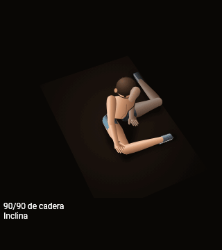
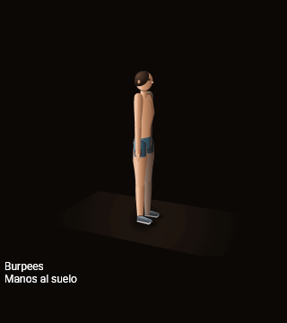
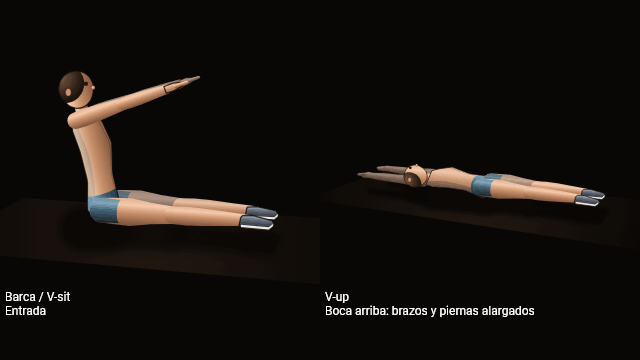
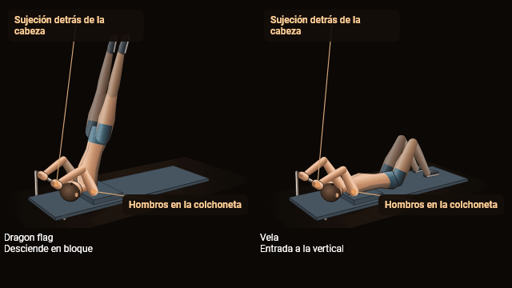
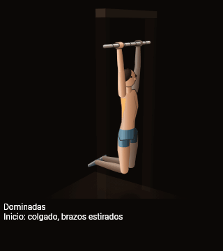
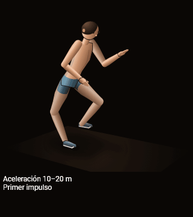
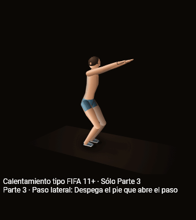

# Vista previa real035

Fuente del render: eef6e067b4a3487247be3d5523acb15bb4af930a. Siete clips del Figure3DPainter real, timeline de producción, 20 fotogramas por segundo de entrada. Sin acelerar ni redibujar. Los pares más cortos indican su pausa final. Los GIF pueden agrupar imágenes idénticas conservando la duración total.

Estado: revisión técnica en curso. Burpees muestra recorte de manos en el ápice; esta evidencia anterior se conserva. Dominadas mantiene oclusión de antebrazo/cabeza; no se ha demostrado un salto cinemático.

## 90/90 de cadera

## Burpees — recorte en revisión

## Barca/V-sit y V-up

## Dragon flag y Vela

## Dominadas

## Aceleración 10–20 m

## FIFA — sólo Parte 3, pasos laterales

Metadatos: manifest.json conserva tiempo, progreso, cámara y SHA por muestra. assembly-receipt.json conserva hashes de todos los PNG y duración verificada del GIF. Las 265 muestras de poses están en ../real-batch2, con comparación baseline/candidato de Dominadas a tres cámaras.
