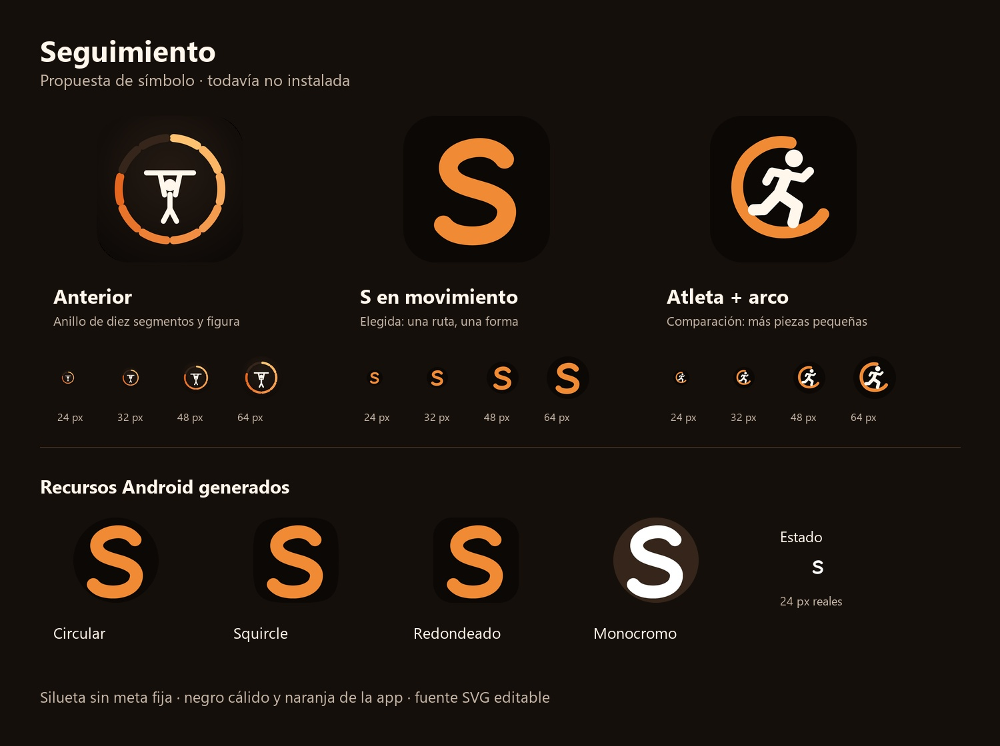
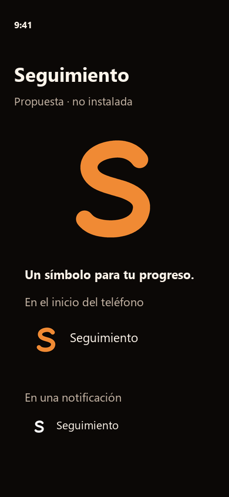

# Logo de Seguimiento: candidata013

Refinamiento local al9-oct-2026, base d2d3070, `JuxnD/013-logo`. No nueva marca
ni rediseño de pantallas. Autoridad: petición del owner de mejorar el logo,
plan013. Paleta/experiencia existentes en docs/diseno y lib/ui/theme, recuperadas
desde INDEX. Impeccable/distill en modoOperate: reconocer la app al abrir el
teléfono, sin pedir una lectura del detalle.

## Dos direcciones y elección

- **S en movimiento**, elegida para recursos: una forma continua, pocos bordes,
  separaciones claras y reconocimiento de inicial a24/48px. Marca general del
  seguimiento físico/comidas/progreso, sin fijar número de rondas.
- **Atleta con arco abierto**, comparación: continuidad con el logo deportivo
  anterior, pero más piezas, cabeza/brazos/piernas compitiendo en pequeño.

Selección basada en inspección visual técnica; no es prueba de preferencia o
comprensión del owner. Son geometrías propias dibujadas aquí, sin copiar una
fuente/marca deportiva; no se realizó búsqueda registral de marca.

Los tamaños pequeños se muestran a sus píxeles reales; el montaje inferior
compone las capas adaptables generadas, no sólo el PNG de tienda. La S sigue
legible como silueta monocroma y en la barra de estado. La alternativa sólo vive
en comparación del renderer; no se envía al APK.

## Fuente y cable a Android

Contrato/generación: [assets/icon/LEEME](../../assets/icon/LEEME.md).
`seguimiento_icon.svg → icon_vector → fuentesPNG → icons.py → mipmap/drawable`.
Cinco densidades preservan `ic_launcher`, foreground y background; agrega
`ic_launcher_monochrome` como alpha blanca propia. `ic_stat_seguimiento` conserva
el nombre de NotificationService. Manifest, package, versión, SDK, firma y
código funcional intactos.

El renderer falla ante estilos/transformaciones no soportados. No se usó
generación raster IA ni dependencias nuevas. Todo el símbolo se deriva de la
misma curvaSVG, con un encuadre óptico diferente para classic/store explicado
en LEEME. Repetir generación conserva hashes en este entorno.

## Verificación y límites

`python tool/icons.py` salida0:25PNGs Android y5fuentes presentes. Verificador
de artefactos prueba dimensiones, alpha, safezone72/108dp, blanco puro en
monocromo/status y nombres de consumidores reales. Mutante status opaco
rechazado incluso con Python -O; el archivo se restauró. Preview20tamaños×4
máscaras generado; detector mecánico delSVG no reportó hallazgos.

La inspección agrupó móvil/desktop. Corrigió huecos del renderer de curvas y
ajustó margen dentro del círculo seguro; no se ocultaron con un PNG distinto.
Inspección valida legibilidad técnica en las muestras, no originalidad registral
ni aceptación humana. Evidencia/hashes: [recibo](../context/sessions/2026-10-09-013-logo.md).

Pendiente en candidata integrada: APKrelease exacto muestra el logo en launcher,
temáticoAndroid13+ y notificación con R8/permisos; aceptación del owner. No se
instaló ni publicó nada por esta tarea.
